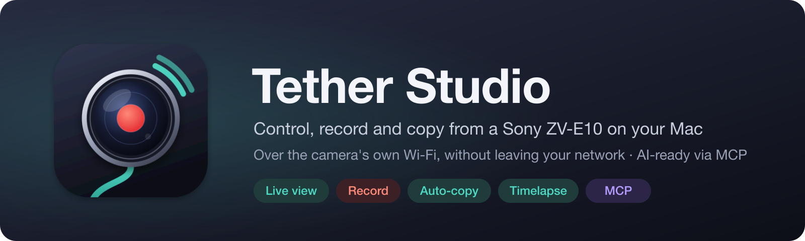
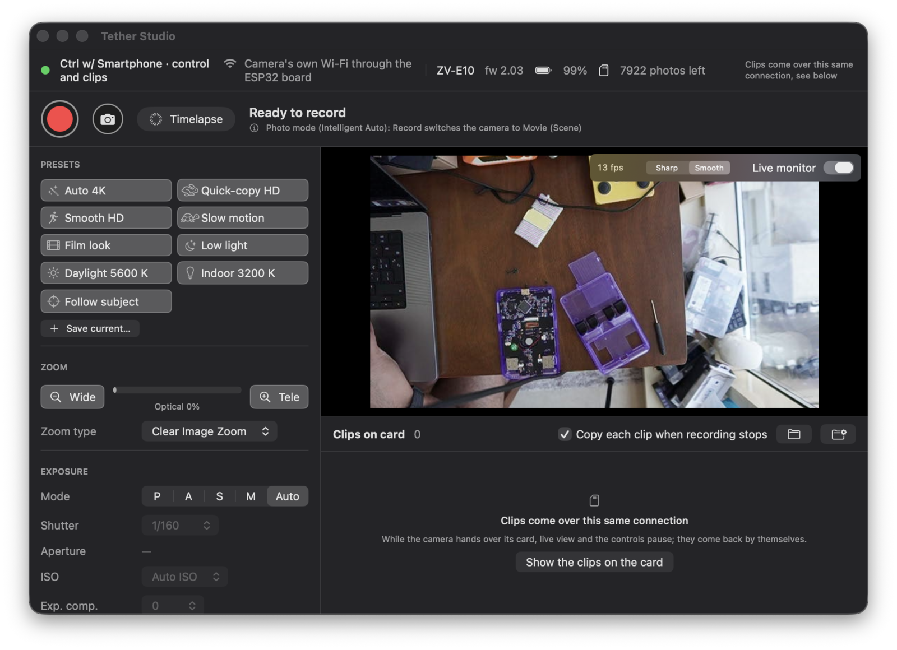
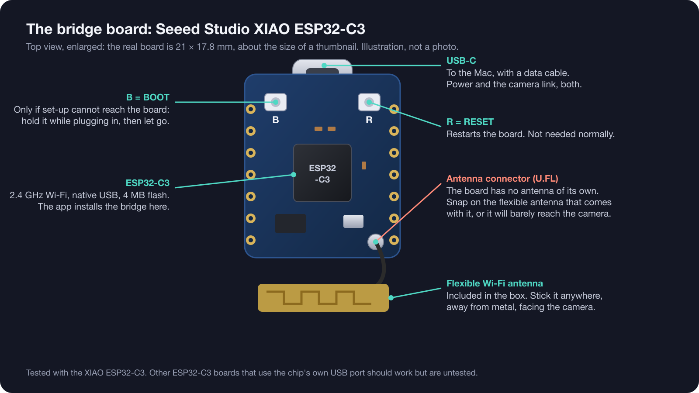
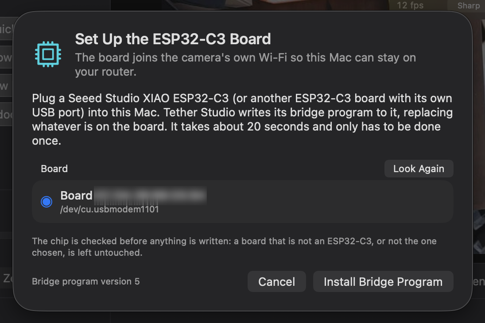
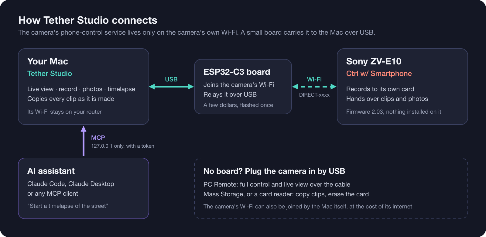
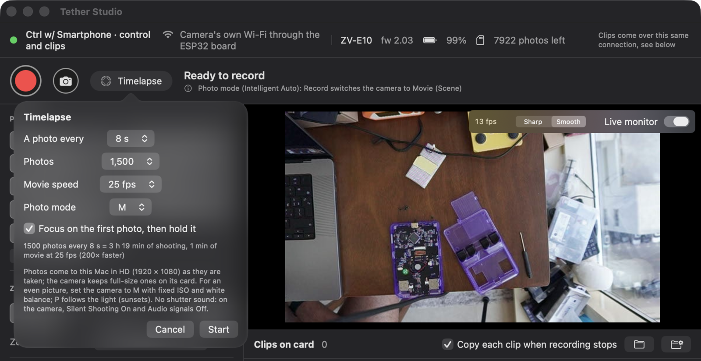

<p align="center">
  
</p>

<p align="center">
  <a href="LICENSE"></a>
  
  
  
</p>

**Tether Studio** is a free, open-source Mac app that remote-controls a **Sony ZV-E10** and brings every
clip to your Mac as soon as it is recorded. It talks to the camera over the camera's own Wi-Fi through a
tiny ESP32-C3 board on USB, so your Mac stays on your normal network, or straight over a USB cable. It
also has an AI interface (MCP), so Claude or any other MCP client can run the camera for you.

> Tether Studio is an independent project. It is not made, endorsed or supported by Sony. "Sony" and
> "ZV-E10" are trademarks of Sony Group Corporation, used here only to say which camera the app works with.

<p align="center">
  
</p>

## Contents

- [What it does](#what-it-does)
- [What you need](#what-you-need)
- [Install](#install)
- [First run](#first-run)
- [How it connects](#how-it-connects)
- [Features in detail](#features-in-detail)
- [AI assistants (MCP)](#ai-assistants-mcp)
- [Privacy and safety](#privacy-and-safety)
- [Build from source](#build-from-source)
- [Project layout](#project-layout)
- [Limits and known issues](#limits-and-known-issues)
- [Licence and credits](#licence-and-credits)

## What it does

| | |
|---|---|
| **Live view** | The camera's picture in the window, with touch-to-focus or tracking where you click. |
| **Record** | Start and stop movies from the Mac (⌘R). A ready check warns about a full card, a low battery or a hot camera before you start. |
| **Clips copied by themselves** | Each take is copied to the Mac when it ends, into a folder per day, over the same Wi-Fi link that controls the camera. Copies that get interrupted pick up where they left off. |
| **Every setting** | Mode, movie format, shutter, aperture, ISO, exposure compensation, white balance and shift, focus mode and area, picture profile, creative look, D-Range Optimizer, zoom type and more. Each row appears only when the camera offers it. |
| **Presets** | One click sets a whole package of settings: ready-made ones (Auto 4K, Smooth HD, Slow motion, Film look, Low light, …) or your own. One can be applied by itself when the camera connects. |
| **Photos and timelapse** | Take photos (⌘T), or run a timelapse: a photo every few seconds for hours, made into a movie on the Mac at the end. It keeps the Mac awake and can lock focus. |
| **Zoom and focus** | Power zoom (Wi-Fi), manual focus steps, autofocus, touch focus and tracking. |
| **Stop alert** | If a take ends without you pressing Stop (card full, battery flat, camera too hot, link lost), you get a sound, a Dock bounce, a notification and a banner. |
| **Camera clock** | Sets the camera's date, time and time zone from the Mac. |
| **Board set-up** | Installs the bridge program on a Seeed XIAO ESP32-C3 with one click, from inside the app. |
| **Erase the card** | Deletes everything on a card mounted as a disk, after showing which files have no copy on this Mac and having you type ERASE. |
| **AI control (MCP)** | 35 tools for AI assistants: status, settings, record, photos, timelapse, focus, zoom, live view picture, presets, clips and the app's options. |

## What you need

- **A Sony ZV-E10.** Tested with firmware 2.03. Other Sony cameras with the same phone-control service
  may work but have not been tried.
- **A Mac with Apple silicon** (M1 or later) running **macOS 13 Ventura or later**.
- **For Wi-Fi (recommended):** a [Seeed Studio XIAO ESP32-C3](https://www.seeedstudio.com/Seeed-XIAO-ESP32C3-p-5431.html)
  board, with the flexible antenna from its box, and a USB-C **data** cable. See
  [The bridge board](#the-bridge-board-xiao-esp32-c3) below.
- **Or a USB cable** straight from the camera to the Mac: full control and live view in PC Remote mode,
  and copying in Mass Storage mode.

### The bridge board: XIAO ESP32-C3

<p align="center">
  
</p>

The [Seeed Studio XIAO ESP32-C3](https://www.seeedstudio.com/Seeed-XIAO-ESP32C3-p-5431.html) is a
thumbnail-sized board (21 × 17.8 mm, about US$5). It joins the camera's own Wi-Fi and relays it to the Mac
over USB, so the Mac stays on your network.

| | |
|---|---|
| Chip | ESP32-C3: 2.4 GHz Wi-Fi, its own USB port (no driver needed), 4 MB flash |
| Antenna | **None on the board.** Attach the flexible antenna that comes in the box to the U.FL connector, or it barely reaches the camera |
| Cable | USB-C **data** cable (charge-only cables don't work) |
| Set-up | **Camera ▸ Set Up ESP32-C3 Board…** installs the bridge program in about 20 s. Nothing else to install: no Arduino, no ESP-IDF, no drivers |
| Buttons | **B** (BOOT): hold it while plugging in if set-up can't reach the board. **R**: reset |
| Range | A few metres from the camera; it measured −40 dBm next to it |
| Speed | About 0.6 MB/s over USB: fine for control and live view; HD clips copy in about twice their length |
| Other boards | Any ESP32-C3 wired to its own USB port should work (for example "C3 SuperMini" boards), but only the XIAO is tested |

Everything about the board (buying, placement, building the firmware yourself, troubleshooting) is in
[docs/BOARD.md](docs/BOARD.md).

## Install

1. Download `TetherStudio-<version>.dmg` from the [latest release](../../releases/latest).
2. Open it and drag **Tether Studio** to **Applications**.
3. Open the app. If macOS says it cannot check the app for malicious software, open
   **System Settings ▸ Privacy & Security**, scroll down and click **Open Anyway**. You only do this once.
   (Release builds that are signed and notarized by Apple open without this step.)
4. When macOS asks whether Tether Studio may find devices on your local network, click **Allow**. It
   needs this to reach the camera.

Each release lists the SHA-256 checksum of the disk image, so you can check your download:

```bash
shasum -a 256 ~/Downloads/TetherStudio-*.dmg
```

## First run

### 1. Set up the board (once)

Attach the flexible antenna to the board's antenna connector (press until it clicks), plug the XIAO
ESP32-C3 into the Mac, and choose **Camera ▸ Set Up ESP32-C3 Board…**. Pick the board (it
is listed by its MAC address) and click **Install Bridge Program**. It takes about 20 seconds.

<p align="center">
  
</p>

The app checks the chip before writing anything. A board that is not an ESP32-C3, or not the one you
picked, is left untouched. If the board does not answer, hold its **BOOT** button (marked **B** on the
XIAO), unplug it and plug it back in while holding the button, let go, and click **Try Again**.

### 2. Put the camera on its own Wi-Fi

On the ZV-E10:

1. **MENU ▸ Network ▸ PC Remote Function ▸ PC Remote:** Off.
2. **MENU ▸ Network ▸ Ctrl w/ Smartphone:** On, then open **Connection**. The camera shows a network
   name (`DIRECT-xxxx:ZV-E10`) and a password.

### 3. Connect

In the app's Wi-Fi panel, turn on **ESP32 bridge**, type the camera's network name and password, and
click **Use**. The board joins the camera, the app connects through it, and the live view appears. The
next time, the app does this by itself as soon as the camera's Connection screen is open.

> **Night shoots and quiet places:** set **Silent Shooting** to On and **Audio signals** to Off on the
> camera, or every timelapse photo clicks.

## How it connects

<p align="center">
  
</p>

The ZV-E10 offers full remote control and access to its card together in one place only: the
**Ctrl w/ Smartphone** service on the camera's own `DIRECT-…` Wi-Fi network. If the Mac joined that
network itself, it would lose its internet. The ESP32-C3 board joins the camera's network instead and
relays the connection over USB. To the app, the camera then appears at `127.0.0.1`. The Mac's own Wi-Fi
stays on your router.

| Connection | Control and live view | Clips copied | Notes |
|---|---|---|---|
| Camera Wi-Fi through the ESP32-C3 board | ✓ | ✓ as they are made | Recommended. About 0.6 MB/s, limited by the board's USB link: an HD 16 Mbit/s clip copies in about twice its length. |
| Mac joined to the camera's Wi-Fi itself | ✓ | ✓ | The Mac has no internet over Wi-Fi meanwhile. |
| USB, camera in PC Remote | ✓ | – | Fastest control. Switch the camera to Mass Storage to copy. |
| USB, camera in Mass Storage, or a card reader | – | ✓ fast | The card appears as a disk; this is also how it can be erased. |

The wire protocol (operation and property codes, the card session, timings and quirks) is written up in
[docs/PROTOCOL.md](docs/PROTOCOL.md).

## Features in detail

### Recording and the ready check

The record bar shows what the camera will record, for example *Movie · 4K 25p 100M · 2 h 13 min on the card ·
battery 85 %*. Before you press Record, it flags what is about to go wrong, worst first:

- **Red:** under a minute of card left, battery at 15 % or less, or the camera is hot.
- **Orange:** under 5 minutes left, battery at 30 % or less, or less room on the Mac than ten minutes of
  clips need.
- **Grey notes:** manual focus, or a photo or S&Q mode (Record switches those to the last movie mode).

### Copying clips

With **automatic copy** on, each take is copied as soon as it ends, into `~/Movies/ZV-E10/<date>/`
(you can choose another folder). The clip list shows what is on the card and what is already on the Mac;
you can also copy any clip by hand. Copying never deletes or overwrites anything on the Mac: a file already there is left alone,
and a copy is only moved into place where nothing exists yet. An interrupted copy continues from where it stopped.

### Presets

The control panel starts with **Presets**. A click sends a whole package of settings, one by one in a
fixed order, waiting for the camera to confirm each. Values the camera does not offer with the current
lens or mode snap to the nearest one it has. The ready-made presets give the 50 Hz value first and the
60 Hz one second, so they work on a camera set to either. None of them sets the aperture, which depends on
the lens. **Save current…** stores your own, with only the groups you tick. **Camera ▸ Preset on
Connect** picks one to apply by itself whenever the camera connects.

### Photos and timelapse

**Take Photo** (⌘T) saves the full-size photo on the card and an HD copy in the day's `Photos` folder on
the Mac. **Timelapse** takes a photo every 4 seconds or more, for as many frames as you choose, then
makes a movie (H.264 at 24, 25 or 30 fps) next to the photos. It keeps the Mac awake, skips a slot rather than
falling behind, and stops after ten failures in a row. A 3 h 20 min night run gave 1,497 of 1,500 frames.

<p align="center">
  
</p>

### Stop alert

If a take stops while you were not the one pressing Stop, Tether Studio tells you why: card full, battery
flat, camera too hot, stopped on the camera, recording failed, or link lost. It plays a sound (louder for
the serious cases), bounces the Dock icon, posts a notification and leaves a banner in the window. To get
the notifications, allow them in **System Settings ▸ Notifications ▸ Tether Studio**. **Camera ▸ Try the
Stop Alert** plays one so you can check.

### Erasing the card

**Camera ▸ Erase Card…** deletes every file on the camera's card, but only while the card is mounted on
the Mac as a disk (the camera in USB Mass Storage mode, or the card in a reader). The camera does not
allow deleting over Wi-Fi at all; use the camera's own **MENU ▸ Setup ▸ Format** there. Before anything is
deleted, a sheet lists the number of files, their size, and in red every clip or photo that has no copy on
this Mac. The Erase button stays off until you type **ERASE**. The app refuses any disk that is not
removable, is larger than 2 TB, or lacks the camera's folder layout.

### Menu reference

| Camera menu | |
|---|---|
| Start / Stop Recording | ⌘R |
| Take Photo | ⌘T |
| Stop Timelapse | |
| Apply Preset ▸ | ⌘1 … ⌘9 |
| Preset on Connect ▸ | |
| Photo Mode ▸ | P, A, S, M or Intelligent Auto |
| Set Camera Clock Now / Set Camera Clock on Connect | |
| Alert When Recording Stops by Itself / Try the Stop Alert | |
| MCP Server for AI Assistants / Copy MCP Setup Command | |
| Autofocus | |
| Refresh Clip List / Copy New Clips / Show Download Folder | |
| Erase Card… | |
| Set Up ESP32-C3 Board… | |

## AI assistants (MCP)

Tether Studio has a built-in [Model Context Protocol](https://modelcontextprotocol.io) server, so an AI
assistant can see and run the camera through the app: *"Set up for a sunset timelapse, a frame every 10
seconds for an hour"*, *"Is the battery OK for a 40-minute interview?"*, *"Copy today's clips"*.

- **Address:** `http://127.0.0.1:8765/mcp` (Streamable HTTP, one JSON reply per request).
- **Only this Mac:** the server listens on the loopback address only, and turns away requests that come
  from a web page.
- **Token:** every request needs `Authorization: Bearer <token>`. The token is created on first launch in
  `~/Library/Application Support/Tether Studio/mcp-token`, readable by your user only.
- **On and off:** **Camera ▸ MCP Server for AI Assistants**.

### Claude Code

**Camera ▸ Copy MCP Setup Command** copies a ready-made command with your token in it. Paste it into
Terminal. It has this form:

```bash
claude mcp add --scope user --transport http tether-studio http://127.0.0.1:8765/mcp --header "Authorization: Bearer $(cat ~/Library/Application\ Support/Tether\ Studio/mcp-token)"
```

### Claude Desktop and other clients

Any MCP client that speaks Streamable HTTP and can send a header works. For clients that only start local
programs (stdio), [`mcp-remote`](https://www.npmjs.com/package/mcp-remote) can bridge. For example, in
Claude Desktop's `claude_desktop_config.json`, with your token in place of `TOKEN`:

```json
{
  "mcpServers": {
    "tether-studio": {
      "command": "npx",
      "args": ["-y", "mcp-remote", "http://127.0.0.1:8765/mcp", "--header", "Authorization: Bearer TOKEN"]
    }
  }
}
```

### Tools

| Group | Tools |
|---|---|
| Status | `get_status`, `get_app_options`, `set_app_option`, `retry_connection` |
| Camera settings | `list_settings`, `set_setting` (only settings on the app's safe list) |
| Recording | `start_recording`, `stop_recording`, `force_stop_recording` |
| Photos and timelapse | `take_photo`, `start_timelapse`, `stop_timelapse` |
| Focus and zoom | `autofocus`, `manual_focus_step`, `touch_focus`, `cancel_touch_focus`, `zoom` |
| Live view | `get_live_view_image` (returns a JPEG the model can look at) |
| Presets and clock | `list_presets`, `apply_preset`, `save_preset`, `delete_preset`, `set_preset_on_connect`, `set_camera_clock` |
| Clips and card | `list_clips`, `refresh_clip_list`, `copy_clips`, `copy_new_clips`, `copy_waiting_takes`, `stop_copy`, `eject_card`, `erase_card` |
| Board | `set_up_board` |
| Stop alert | `clear_stop_alert`, `try_stop_alert` |

Each tool runs through the same code as the window's buttons, with the same checks. Two things always
stay with a person: **`erase_card`** and **`set_up_board`** only open their sheet in the app, and someone
has to type ERASE or click Install there. The camera's Wi-Fi password is never handed to a client.

## Privacy and safety

- **No accounts, no cloud, no tracking.** The app talks only to the camera, the board and AI clients on
  the same Mac.
- **What it keeps:** settings in the app's preferences, and the board settings, presets and the MCP token
  in `~/Library/Application Support/Tether Studio/`. The camera's Wi-Fi password is stored in
  `bridge.json` there, readable by your user only. On the board it is kept in memory only, never in its
  flash.
- **Your files:** copying never deletes or overwrites anything on the Mac. The only thing that deletes is
  Erase Card, on a card you confirmed by typing ERASE.
- **Your camera:** the app sends only operations on a fixed list. It never sends firmware-update or
  card-format commands to the camera.
- **Your board:** only ESP32-C3 chips are written, after their chip type and MAC address are checked.

Found a security problem? See [SECURITY.md](SECURITY.md). The privacy policy is in [PRIVACY.md](PRIVACY.md).

## Build from source

You need Xcode 15 or later (or the Command Line Tools with Swift 5.9+) and [Homebrew](https://brew.sh).

```bash
brew install libgphoto2
```

```bash
git clone https://github.com/moheshmohan/tether-studio.git && cd tether-studio/TetherStudio
```

```bash
swift test
```

```bash
scripts/make_app.sh
```

`scripts/make_app.sh` builds `build/Tether Studio.app`, with libgphoto2 and its plug-ins copied into the
bundle so the app runs on Macs without Homebrew. For a release that also runs on macOS 13–15, first build
those libraries for macOS 13 with `scripts/build_deps.sh`. It builds from the source archives in Homebrew's
cache (`brew fetch --build-from-source libgphoto2 libtool libusb`), since Homebrew's own builds need the
newest macOS. `scripts/make_dmg.sh` also packs the disk image into
`dist/`. With `SIGN_ID` (a Developer ID Application identity) and `NOTARY_PROFILE` set, it signs and
notarizes the image too.

### The board's bridge program

The firmware source is in [`esp32_bridge/idf`](esp32_bridge/idf) (ESP-IDF 5.3). The app ships a prebuilt
image in `TetherStudio/Resources/firmware/`. To rebuild it:

```bash
esp32_bridge/build_firmware.sh
```

You can also flash it without the app, with esptool:

```bash
cd esp32_bridge/idf && idf.py -p /dev/cu.usbmodemXXXX flash
```

### Command-line checks

The app binary has text-only test modes. Quit the app first, since only one program can use the board at
a time.

| Command | What it does |
|---|---|
| `TetherStudio --wifi-check --bridge` | Connects through the board and prints the camera's state. |
| `TetherStudio --wifi-check --bridge --all-controls` | Also lists every setting and its choices. |
| `TetherStudio --card-check --bridge` | Lists the card over phone control. |
| `TetherStudio --usb-check` | What the camera offers on the USB cable. |
| `TetherStudio --wifi-check --bridge --photo 3` | Takes three photos. |
| `TetherStudio --board-ports` | Lists USB serial ports and the board MAC addresses (sends nothing). |
| `TetherStudio --board-identify /dev/cu.usbmodemXXXX` | Reads the chip type and MAC from the board's bootloader. |
| `TetherStudio --flash-board /dev/cu.usbmodemXXXX` | Installs the bridge program. |

From a source build, run them as `.build/debug/TetherStudio …`.

## Project layout

| Path | |
|---|---|
| [`TetherStudio/`](TetherStudio) | The Mac app (SwiftUI, Swift Package). `Sources/GPhotoC` is a thin C wrapper around libgphoto2. |
| [`esp32_bridge/`](esp32_bridge) | The ESP32-C3 bridge program (ESP-IDF in `idf/`, an older Arduino version) and `relay.py`, a Python stand-in for the app's side of the bridge. |
| [`zve10/`](zve10), [`tests/`](tests), [`probe/`](probe) | The project's first prototype: a Python library and command line for the same camera, with a mock camera for tests. |
| [`docs/`](docs) | The board guide, the protocol notes, the App Store guide, and the README's images. |

## Limits and known issues

- Tested on one ZV-E10 with firmware 2.03. Menu names may differ slightly on other firmware.
- Copying over the board runs at about 0.6 MB/s. For long 4K takes, a card reader or USB Mass Storage is
  faster.
- Over Wi-Fi, reading the card's list pauses live view and control for a moment.
- A card cannot be erased over Wi-Fi (the camera does not allow it).
- Apple silicon only for now: the bundled libgphoto2 is built for arm64.
- The app is not on the Mac App Store yet. A sandboxed App Store build is ready; see
  [docs/APP_STORE.md](docs/APP_STORE.md).

## Licence and credits

Tether Studio is released under the [MIT License](LICENSE).

The app bundles [libgphoto2](https://github.com/gphoto/libgphoto2), libltdl and libusb, unmodified and
under the LGPL 2.1. See
[THIRD_PARTY_NOTICES.md](THIRD_PARTY_NOTICES.md) for the licences and where to get their source. The board
image is built with Espressif's [ESP-IDF](https://github.com/espressif/esp-idf) (Apache-2.0).

This project was built for interoperability: so that a camera you own can work with your own computer.
It does not contain any Sony software, firmware or documentation. Use it at your own risk.
