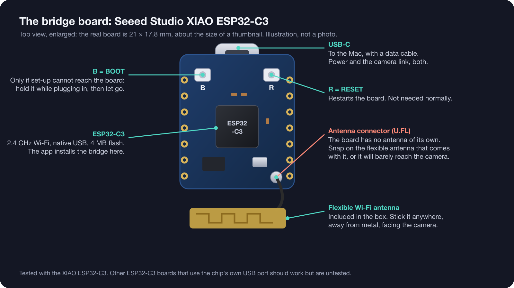

# The Wi-Fi bridge board: Seeed Studio XIAO ESP32-C3

<p align="center">
  
</p>

## Why a board at all

The ZV-E10 offers full remote control and its card together in only one place: the **Ctrl w/
Smartphone** service on the camera's own `DIRECT-…` Wi-Fi network. If your Mac joined that network, it
would drop off your normal Wi-Fi and lose its internet.

The board solves this. It joins the camera's network itself and relays the connection to the Mac over
USB. The Mac stays on your router, and to Tether Studio the camera simply appears at `127.0.0.1`.

```
Mac (your Wi-Fi + internet)  ──USB──  XIAO ESP32-C3  ~~camera's Wi-Fi~~  ZV-E10
```

## What to buy

| | |
|---|---|
| **Board** | [Seeed Studio XIAO ESP32-C3](https://www.seeedstudio.com/Seeed-XIAO-ESP32C3-p-5431.html), about US$5. Also sold by DigiKey, Mouser and Amazon. The pin headers are not needed. |
| **Antenna** | The flexible Wi-Fi antenna that comes in the box. Nothing extra to buy. |
| **Cable** | USB-C to USB-C (or USB-A) **data** cable. Many cheap cables only charge; with one of those the board does not show up at all. |
| **Case (optional)** | Any small case, or a bit of heat-shrink. Keep the antenna outside any metal. |

**Chip:** ESP32-C3, a 160 MHz RISC-V CPU with 2.4 GHz Wi-Fi (802.11 b/g/n) and Bluetooth LE, 400 KB RAM
and 4 MB flash. It has its own USB port, so the Mac needs no driver; the board shows up as
`/dev/cu.usbmodem…`.

**Other boards:** any ESP32-C3 board that is wired to the chip's own USB port ("USB-Serial/JTAG") should
work, for example the many "ESP32-C3 SuperMini" boards. These are untested. Boards with a separate
USB-serial chip (CH340, CP2102) are a different design and are not supported. Other ESP32 chips (S2, S3,
C6, the original ESP32) are refused by the app's set-up on purpose.

## Set it up (once)

1. **Attach the antenna.** Press the small round plug of the flexible antenna onto the gold **U.FL**
   connector until it clicks. The XIAO ESP32-C3 has no antenna printed on the board. Without the antenna
   it reaches the camera only from a few centimetres away, if at all.
2. **Plug it into the Mac** with a data cable.
3. In Tether Studio, choose **Camera ▸ Set Up ESP32-C3 Board…**. The board is listed by its MAC address.
   Pick it and click **Install Bridge Program**. It takes about 20 seconds.

The app first checks, using the chip's built-in bootloader, that the board really is an ESP32-C3 and
that its MAC address matches the one you picked. Only then does it write. Afterwards it reads the flash
back to check what was written, and restarts the board into the bridge program. Whatever was on the board
before is replaced.

**If set-up says the board does not answer:** hold the **B** (BOOT) button, unplug the board and plug it
back in while holding the button, let go, and click **Try Again**. This forces the chip into its
bootloader, whatever program is on it.

## Use it

1. On the camera: **MENU ▸ Network ▸ PC Remote Function ▸ PC Remote: Off**, then **Ctrl w/ Smartphone:
   On**, and open **Connection**. The camera shows its network name and password.
2. In Tether Studio's Wi-Fi panel: turn on **ESP32 bridge**, type that name and password, and click
   **Use**.

From then on, the app joins by itself whenever the camera's Connection screen is open. The board keeps the
password in its memory only: it is sent over USB each time and is gone when the board is unplugged.

## Placement and range

- The camera's own Wi-Fi is not strong. Keep the board within a few metres of the camera, with a clear line
  of sight if you can. On a desk next to the camera it measured −40 dBm, a very strong signal.
- Point the flexible antenna toward the camera, and keep it away from the Mac's metal body. A short USB
  extension cable helps if the Mac's ports face away from the camera.
- The Wi-Fi panel shows the signal (for example "joined … (signal −40 dBm)"). As a general Wi-Fi rule,
  around −70 dBm and weaker the link gets slower and less reliable.

## Speed

The board's USB link carries about **0.6 MB/s**. That covers control and live view easily. An HD clip
at 16 Mbit/s copies in about twice its length. For long 4K takes, a card reader or USB Mass Storage
is much faster.

## Without the app

The bridge program's source is in [`esp32_bridge/idf`](../esp32_bridge/idf) (ESP-IDF 5.3). To build and
flash it with Espressif's tools instead of the app:

```bash
cd esp32_bridge/idf && idf.py -p /dev/cu.usbmodemXXXX flash
```

`esp32_bridge/build_firmware.sh` rebuilds the image the app ships. The USB message format is described in
[PROTOCOL.md §12](PROTOCOL.md#12-the-esp32-c3-bridge-and-its-usb-framing).

## Troubleshooting

| What you see | What to do |
|---|---|
| "No board on USB" | Try another cable (it must carry data) and another port. `TetherStudio --board-ports` lists what macOS sees. |
| "The board on … does not run the bridge program yet" | Run **Set Up ESP32-C3 Board…**. |
| Set-up: "did not answer in its bootloader" | Use the BOOT button method above. |
| Set-up: "This board is an ESP32-S3 …" | That is not an ESP32-C3; the app left it untouched. |
| "Cannot join DIRECT-…: the camera refused the password" | Retype the password from the camera's Connection screen; it changes if the camera's SSID/PW is reset. |
| "Cannot join DIRECT-…: the network is not in range" | Open the camera's Connection screen (its network exists only then), and check the antenna. |
| Joins, then drops | Attach the antenna, move the board closer to the camera, or move it away from metal. |
